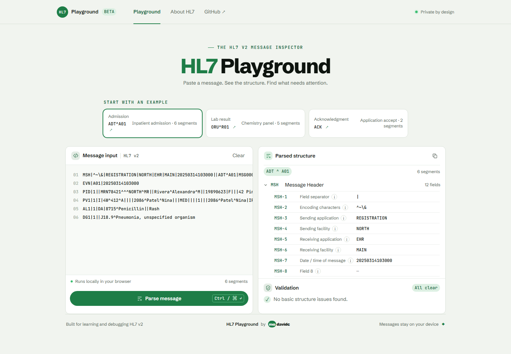

# HL7 Playground

<p>
  <a href="https://github.com/modavidc/hl7-playground/tags"></a>
  <a href="https://github.com/modavidc/hl7-playground/actions/workflows/pages.yml"></a>
  <a href="LICENSE"></a>
</p>

**Explore an HL7 v2 message as a structure you can understand.** Paste a message to inspect its segments and fields, expand components, and see where basic checks find problems. Parsing happens in your browser.

Built under the **modavidc** personal brand.

**Current version:** `v0.1.0` · preview release. Interfaces and field coverage may change before `1.0.0`.



## Why this exists

HL7 v2 is common in healthcare integrations, but its compact segment format makes messages difficult to read by eye. HL7 Playground turns that text into an explorable view and explains common fields as you inspect them.

## Try it

The planned [GitHub Pages demo](https://modavidc.github.io/hl7-playground/) will be available after the repository is published and Pages is set to **GitHub Actions**. Until then, run it locally:

```sh
npm ci
npm run dev
```

## Releases

The project follows semantic versioning. Versions below `1.0.0` are previews, so parser behavior and field definitions can still change. See [CHANGELOG.md](CHANGELOG.md) for the release history.

## Features

- Parses HL7 v2 messages using the delimiters declared in MSH.
- Preserves fields, repetitions, components, and subcomponents.
- Explains common MSH, EVN, PID, PV1, AL1, DG1, ORC, OBR, OBX, and MSA fields.
- Checks for a missing or malformed MSH, invalid segment separators, mixed line endings, and blank common required fields.
- Includes ADT^A01, ORU^R01, and ACK examples.
- Keeps parsing and fonts local to the browser; message content is not sent to a service.

## Quality checks

```sh
npm test
npm run build
```

The test suite covers header indexing, delimiter handling, line endings, nested field structure, empty fields, validation locations, and all built-in examples. The GitHub Pages workflow runs the same checks before publishing.

## Scope and limits

This is an educational inspector and basic structural checker. It does not validate an implementation guide or certify conformance, decode HL7 escape sequences, parse MLLP framing, or replace a production interface engine. Some fields change meaning or data type by version and message profile; the built-in field guide covers common v2.5 use and labels values such as OBX-5 as dependent on OBX-2. Examples contain synthetic data. Do not use this tool for clinical decisions.

## Built-in field references

Names and descriptions are intended as a quick guide. See the HL7-maintained references for additional context:

- [MSH segment mapping](https://hl7.org/fhir/uv/v2mappings/ConceptMap-segment-msh-to-encounter.html)
- [PID segment mapping](https://www.hl7.org/fhir/uv/v2mappings/ConceptMap-segment-pid-to-patient.html)
- [OBX segment mapping](https://www.hl7.org/fhir/uv/v2mappings/ConceptMap-segment-obx-to-observation.html)

## Licensing

The project source is available under the [MIT License](LICENSE). Bundled Schibsted Grotesk and JetBrains Mono font files have their own SIL Open Font License notices in `public/fonts/FONT-LICENSES.txt`.

## Project structure

- `src/parser.ts` parses messages, runs basic checks, and contains the built-in field guide.
- `src/examples.ts` contains the synthetic demonstration messages.
- `src/main.ts` renders the single-page inspector.
- `src/styles.css` applies the modavidc Design System V2 typography and colors.
- `test/parser.test.mjs` exercises parser and validation behavior with Node's built-in test runner.
- `.github/workflows/pages.yml` tests, builds, and deploys the static app to GitHub Pages.
- `public/fonts/FONT-LICENSES.txt` carries the licenses for the bundled font files.

## Roadmap

- Expand field coverage and version-specific definitions.
- Add optional message profiles for deeper validation.
- Add downloadable JSON exports and a shareable sample library.
