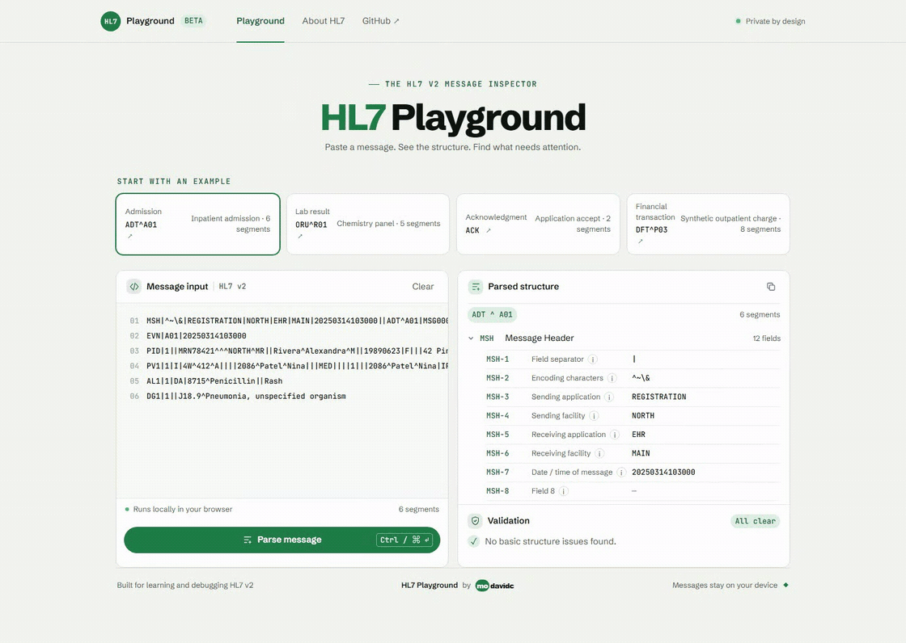

# HL7 Playground

<p align="center">
  
  
  
  <a href="https://github.com/modavidc/hl7-playground/tags"></a>
  <a href="https://github.com/modavidc/hl7-playground/actions/workflows/ci.yml"></a>
  <a href="https://github.com/modavidc/hl7-playground/actions/workflows/pages.yml"></a>
  <a href="LICENSE"></a>
</p>

Inspect HL7 v2 messages in the browser, trace each field to its segment, and review structural warnings without sending data to a remote service.

Built for HL7 integrators, interoperability analysts, QA teams, and developers debugging message flow.

<p>
  <a href="https://modavidc.github.io/hl7-playground/">🚀 Open the live demo</a> ·
  <a href="https://github.com/modavidc/hl7-playground/issues/new?template=bug_report.yml">🐛 Report a bug</a> ·
  <a href="https://github.com/modavidc/hl7-playground/issues/new?template=feature_request.yml">💡 Request a feature</a>
</p>

<p align="center">
  <a href="screenshots/hl7-playground-demo.gif"></a>
  <br>
  <sub>Click the demo to open the full-size GIF.</sub>
</p>

## What it does

HL7 v2 messages are compact and hard to scan by eye. HL7 Playground separates a message into an expandable tree so you can follow each value back to its segment and field.

- Parses delimiters declared in `MSH` and preserves fields, repetitions, components, and subcomponents.
- Explains common fields across `MSH`, `EVN`, `PID`, `PV1`, `AL1`, `DG1`, `ORC`, `OBR`, `OBX`, `FT1`, `IN1`, `GP1`, `PR1`, and `MSA`.
- Flags a missing or malformed `MSH`, invalid segment separators, mixed line endings, and blank fields used by its basic checks.
- Jumps from a validation finding to the matching segment or field in the parsed tree when a location is available.
- Includes built-in examples such as `ADT^A01`, `ORU^R01`, `ACK`, and a synthetic `DFT^P03` financial transaction.
- Opens `.hl7` and `.txt` files locally in the browser. File contents are not uploaded.
- Keeps parsing and fonts in the browser. Message content is not sent to a service.
- No configuration is required for local use.
- Input is limited to 512,000 characters and imported files to 2 MB.

## Quick start

Paste a message or choose a built-in example, then select **Parse message**.

```text
MSH|^~\&|SENDER|FACILITY|RECEIVER|FACILITY|20260101120000||ADT^A01|MSG0001|P|2.5
PID|1||DEMO-001^^^FACILITY^MR||Sample^Patient
PV1|1|O
```

Expand `PID` to inspect its fields. Select a field name for its explanation; if validation finds an issue, choose **View in tree** to jump to the matching location.

### Run locally

```sh
git clone https://github.com/modavidc/hl7-playground.git
cd hl7-playground
npm ci
npm run dev
```

Open the local URL printed by Vite, then choose an example or paste your own HL7 v2 message and select **Parse message**.

## Troubleshooting

| Problem | What it means | How to fix |
|---|---|---|
| Message does not parse | `MSH` is missing or malformed, or separators are invalid | Keep the `MSH` header intact and verify the field and encoding separators in `MSH-1` and `MSH-2` |
| File is rejected | The file is too large or not a supported text format | Use a `.hl7` or `.txt` file under 2 MB |
| Warning remains | This is a structural warning, not a conformance result | Review the location in the tree and confirm profile-specific requirements with your integration documentation |
| Message contains mixed line endings | Input includes a mix of `CR`, `LF`, and `CRLF` segments | Normalize the input to a single line-ending style before parsing |

## Tests

```sh
npm test
npx playwright install chromium
npm run test:ui
npm run build
```

The parser tests cover delimiter handling, line endings, nested field structure, limits, validation locations, and built-in examples. Browser tests cover parsing, local file loading, field guidance, keyboard focus, accessibility announcements, and local `Z` segments. Pull requests run both test suites and a production build. CI runs the same checks before deployment.

## Architecture

```text
hl7-playground/
├── .github/
│   ├── ISSUE_TEMPLATE/
│   │   ├── bug_report.yml
│   │   ├── config.yml
│   │   └── feature_request.yml
│   └── workflows/
│       ├── ci.yml                 # Pull request checks
│       └── pages.yml              # Test, build, and deploy to GitHub Pages
├── e2e/
│   └── playground.spec.ts         # Browser interaction tests
├── public/
│   └── fonts/                     # Locally served fonts and license notices
├── screenshots/
│   └── hl7-playground-demo.gif
├── src/
│   ├── examples.ts                # Synthetic demo messages
│   ├── html.ts                    # Escapes untrusted message content
│   ├── main.ts                    # Single-page interface and tree rendering
│   ├── parser.ts                  # HL7 v2 parsing, field guide, and basic checks
│   ├── styles.css                 # modavidc Design System V2
│   └── types.ts                   # Parser data types
├── test/
│   ├── html.test.mjs
│   └── parser.test.mjs
├── index.html
├── package.json
├── playwright.config.ts
├── tsconfig.json
├── CHANGELOG.md
├── LICENSE
├── README.md
└── package-lock.json
```

## Version

The latest tag is `v0.1.0`, a preview release. Changes on `main` after that tag are not part of a release yet. Parser behavior and field coverage may change before `1.0.0`.

## Scope and limits

This is an educational inspector with basic structural checks. It does not validate an implementation guide or certify conformance, decode HL7 escape sequences, parse MLLP framing, or replace a production interface engine.

- Input is limited to 512,000 characters and 500 non-empty segments.
- Imported files are capped at 2 MB.
- Field guidance covers common `v2.5` usage. Field meaning can vary by version and message profile.
- `Z` segments are local extensions whose meaning depends on the sending implementation.
- Examples contain synthetic data.
- Do not include real patient information in public bug reports or feature requests.

## HL7 references

These references provide additional context for common segment fields:

- [MSH segment mapping](https://hl7.org/fhir/uv/v2mappings/ConceptMap-segment-msh-to-encounter.html)
- [PID segment mapping](https://www.hl7.org/fhir/uv/v2mappings/ConceptMap-segment-pid-to-patient.html)
- [OBX segment mapping](https://www.hl7.org/fhir/uv/v2mappings/ConceptMap-segment-obx-to-observation.html)
- [HL7 v2.5.1 financial management segments](https://www.hl7.eu/HL7v2x/v251/std251/ch06.html)

## Feedback and contributions

Use the issue forms to [report a bug](https://github.com/modavidc/hl7-playground/issues/new?template=bug_report.yml) or [request a feature](https://github.com/modavidc/hl7-playground/issues/new?template=feature_request.yml). Contributions are welcome for parser edge cases, validation logic, examples, and usability improvements.

## License

The project source is available under the [MIT License](LICENSE). Bundled Schibsted Grotesk and JetBrains Mono font files have separate SIL Open Font License notices in `public/fonts/FONT-LICENSES.txt`.
